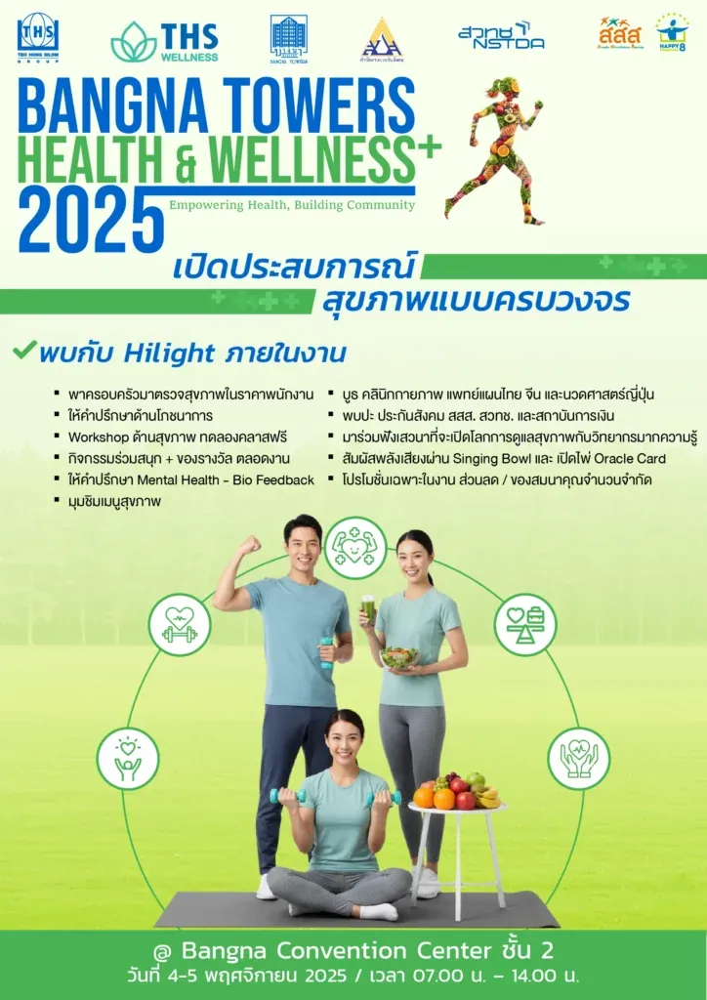
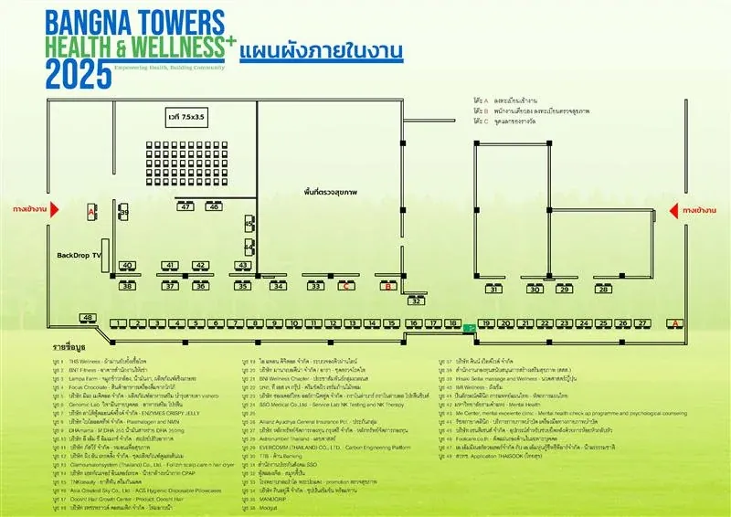

ปรากฏการณ์ครั้งสำคัญของวงการสุขภาพกำลังจะเกิดขึ้นในงาน **Bangna Towers Health & Wellness 2025** ซึ่งจะจัดขึ้นระหว่างวันที่ **4-5 พฤศจิกายน 2568 ณ Bangna Convention Center ชั้น 2** โดยเป็นเวทีสำคัญสำหรับผู้ประกอบการ นักลงทุน และผู้ที่ใส่ใจในสุขภาพ ที่จะได้มาอัปเดตเทรนด์และนวัตกรรมล่าสุดที่กำลังจะเข้ามามีบทบาทในการกำหนดทิศทางของอุตสาหกรรม Wellness ในอนาคต

ที่สำคัญ งานนี้ยังเป็นการรวบรวมทุกมิติของ **'สุขภาวะองค์รวม' (Holistic Wellness)** มาไว้ในที่เดียวอย่างครบวงจร ภายใต้แนวคิดหลัก **“Empowering Health, Building Community”** โดยมุ่งเน้นการสร้างแพลตฟอร์มที่เชื่อมโยงองค์ความรู้ ผลิตภัณฑ์ บริการ และเครือข่ายทางธุรกิจเข้าไว้ด้วยกัน เพื่อขับเคลื่อนสังคมไปสู่การมีสุขภาพที่ดีอย่างยั่งยืนและครอบคลุมในทุกมิติ

## เจาะลึก 3 มิติแห่งสุขภาวะจากบูธภายในงาน

งานนี้ได้รวบรวมองค์ความรู้และบริการต่าง ๆ โดยแบ่งตามแกนหลักของสุขภาวะองค์รวม เพื่อให้ผู้เข้าร่วมงานสามารถเลือกสำรวจสิ่งที่สนใจได้อย่างเป็นระบบ

### 1. สุขภาวะทางกาย (Physical Wellness) รากฐานของชีวิตที่แข็งแรง

มิตินี้มุ่งเน้นการดูแลป้องกันและฟื้นฟูร่างกายให้ทำงานได้อย่างเต็มศักยภาพ ผู้เข้าร่วมงานจะได้พบกับ

- **บริการตรวจคัดกรองสุขภาพ** - ประเมินความเสี่ยงและเช็กความพร้อมของร่างกายเบื้องต้นโดยทีมแพทย์และบุคลากรมืออาชีพ

- **ศาสตร์การบำบัดฟื้นฟู**  - พบกับผู้เชี่ยวชาญจาก **รัชตกายาคลินิก (บูธ 44)** ที่นำเสนอเครื่องมือและบริการกายภาพบำบัดที่ทันสมัย และ **Hisaki Seitai (บูธ 39)** กับศาสตร์การนวดจัดกระดูกจากญี่ปุ่นเพื่อปรับสมดุลโครงสร้างร่างกาย

- **นวัตกรรมผลิตภัณฑ์เสริมอาหาร** - เลือกสรรผลิตภัณฑ์ที่เหมาะกับคุณจาก **Genomic Lab (บูธ 6)** ที่เชี่ยวชาญด้านวิตามินเฉพาะบุคคล หรือ **DHAmama (บูธ 9)** กับผลิตภัณฑ์น้ำมันสาหร่าย DHA คุณภาพสูง

### 2. สุขภาวะทางใจและอารมณ์ (Mental & Emotional Wellness) สร้างความสมดุลจากภายใน

ความเครียดและความท้าทายในชีวิตประจำวันทำให้สุขภาพจิตกลายเป็นเรื่องสำคัญอันดับต้นๆ ภายในงานจึงมีพื้นที่สำหรับดูแลมิตินี้โดยเฉพาะ

- **มุมให้คำปรึกษาโดยผู้เชี่ยวชาญ** - เปิดโอกาสให้พูดคุยปัญหาสุขภาพจิตกับนักจิตวิทยาจาก **Me Center (บูธ 43)** เพื่อหาแนวทางจัดการความเครียดและความวิตกกังวล

- **กิจกรรมบำบัดเพื่อความผ่อนคลาย** - สัมผัสประสบการณ์ลดความตึงเครียดด้วยกิจกรรม **Singing Bowl** ที่ใช้คลื่นเสียงเข้าปรับสมดุลของคลื่นสมองและจิตใจ

### 3. นวัตกรรมและสุขภาวะทางธุรกิจ (Technological & Business Wellness)

เพื่อให้ Ecosystem ของ Wellness เติบโตอย่างยั่งยืน เทคโนโลยีและเครือข่ายทางธุรกิจคือองค์ประกอบที่ขาดไม่ได้

- **เทคโนโลยียกระดับบริการ -**  พบกับ **[ไอ แพลน ดิจิตอล จำกัด](https://www.iplandigital.co.th/) (บูธ 19)** ที่จะมานำเสนอ **["ระบบจองคิวผ่านไลน์"](https://foxconnect.app/th/)** โซลูชันอันทรงพลังสำหรับคลินิกและธุรกิจบริการ ที่ช่วยเพิ่มประสิทธิภาพการจัดการและสร้างประสบการณ์ที่ดีเยี่ยมให้แก่ลูกค้า

- **แพลตฟอร์มสร้างเครือข่ายธุรกิจ** - ห้ามพลาดกับบูธ **[BNI Wellness Chapter](https://bniwellness.com/) (บูธ 21)** ซึ่งเป็นศูนย์รวมของผู้ประกอบการมืออาชีพในอุตสาหกรรมสุขภาพ ที่มารวมตัวกันเพื่อสร้างคอนเน็กชันและส่งมอบโอกาสทางธุรกิจผ่านระบบการตลาดแบบบอกต่อ (Referral Marketing) อย่างมีประสิทธิภาพ

นอกจากนี้ ภายในงานยังสร้างบรรยากาศที่คึกคักด้วยเวทีเสวนาให้ความรู้, Workshop ทดลองคลาสฟรี, กิจกรรมร่วมสนุกชิงของรางวัลตลอดงาน, และโปรโมชันส่วนลดเฉพาะในงานอีกมากมาย

## Bangna Towers Health & Wellness 2025 โอกาสสำหรับผู้ประกอบการ

งาน Bangna Towers Health & Wellness 2025 ถือเป็นเวทีเชิงกลยุทธ์สำหรับแบรนด์ในการสร้างการรับรู้และเข้าถึงกลุ่มเป้าหมายคุณภาพ และเป็นโอกาสสำคัญสำหรับผู้ประกอบการ หรือเจ้าของธุรกิจที่สนใจเข้าร่วมงาน โดยมีรายละเอียด ดังนี้

- **การจัดเตรียมพื้นที่** ผู้แสดงสินค้าสามารถเข้าดำเนินการตกแต่งบูธล่วงหน้าได้ในวันที่ 3 พ.ย. 2568 ระหว่างเวลา 14.00-17.00 น.

- **สิ่งอำนวยความสะดวก**  ผู้จัดงานได้เตรียมโต๊ะขนาด 1.80 x 0.45 เมตร และเก้าอี้ 2 ตัวไว้เป็นมาตรฐาน และจัดสรรพื้นที่จอดรถพิเศษ ณ อาคาร D ชั้น 4 (กรุณาแสดงป้าย "Exhibitor")

- **ข้อแนะนำ** เพื่อประสิทธิภาพสูงสุด ขอความร่วมมือผู้แสดงสินค้าประจำบูธตลอดระยะเวลาการจัดงานทั้ง 2 วัน และเตรียมปลั๊กพ่วงมาเองในกรณีที่ต้องใช้อุปกรณ์ไฟฟ้า

เชิญมาร่วมเป็นส่วนหนึ่งของประสบการณ์สุขภาพแบบบูรณาการ ที่ซึ่งทุกมิติของสุขภาวะมาบรรจบกันในวันที่ 4-5 พฤศจิกายน 2568 ตั้งแต่เวลา 07.00 - 14.00 น. ณ Bangna Convention Center และหากธุรกิจ Wellness ของคุณกำลังมองหาพาร์ทเนอร์ด้านการตลาดที่เข้าใจอุตสาหกรรมอย่างลึกซึ้ง **ติดต่อ I Plan Wellness เพื่อรับคำปรึกษาได้ [ที่นี่](/)**

## กำหนดการงาน Bangna Towers Health & Wellness 2025

### วันที่ 4 พฤศจิกายน 2568

**07.00 – 14.00 น.**  
ตรวจสุขภาพประจำปีพนักงาน

**08.30 – 09.00 น.**  
ลงทะเบียนเข้างาน

**09.00 – 09.30 น.**  
**พิธีเปิดงาน (Opening Ceremony)**

- กล่าวต้อนรับโดยผู้บริหารอาคารบางนา ทาวเวอร์ และผู้บริหารกลุ่มบริษัทเตียวฮงสีลม
- แถลงวัตถุประสงค์โครงการ “Bangna Towers Health & Wellness 2025: Empowering Health, Building Community”
- กล่าวเปิดงานโดย **กัลยกร ศิริรัตน์อัสดร** กรรมการบริหาร กลุ่มบริษัทเตียวฮงสีลม กล่าวร่วมต้อนรับ **คุณทิพาพรรณ ภัทรวิกรม** Executive Director กลุ่มการลงทุนอสังหาริมทรัพย์และโครงสร้างพื้นฐาน บลจ.ไทยพาณิชย์ (POPF อาคารบางนา ทาวเวอร์), สสส., สวทช., BNI Wellness และ พันธมิตร
- กล่าวแสดงความร่วมมือโดย **คุณจีริสุดา เอี่ยมสกุล** หัวหน้าสำนักงานประกันสังคมจังหวัดสมุทรปราการ สาขาบางพลี

**09.30 – 10.00 น.**  
**ผู้บริหาร ผู้เข้าร่วมงาน เยี่ยมชมบูธสุขภาพ**  
เยี่ยมชมบูธตรวจสุขภาพ โภชนาการ ฟิตเนส การแพทย์แผนต่าง ๆ และพันธมิตรต่าง ๆ

**10.30 – 10.50 น.**  
**ช่วงบรรยายความรู้บนเวที**  
**บรรยายพิเศษ หัวข้อ: “Happy 8 สูตรลับสร้างสุขภาวะองค์กร”**  
โดย ผู้อำนวยการสำนักสนับสนุนสุขภาวะองค์กร (สำนัก 8) สสส.  
เนื้อหา: แนวทางการสร้างองค์กรแห่งความสุข ร่วมกับภาคีเครือข่ายและภาคประชาสังคม เพื่อส่งเสริมสุขภาวะในสถานที่ทำงานอย่างยั่งยืน

**10.50 – 11.20 น.**  
**เสวนา Roundtable: “WELLNESS x 6: ศาสตร์บำบัด 6 มิติ เพื่อชีวิตไร้ขีดจำกัด”**  
เรียนรู้การดูแลสุขภาพแบบองค์รวมจากศาสตร์แพทย์ตะวันออกและกายภาพบำบัด เพื่อป้องกันออฟฟิศซินโดรมและสร้างสมดุลชีวิตคนทำงานยุคใหม่  
ผู้ร่วมเสวนา:

- แพทย์แผนจีน – IMI Wellness
- แพทย์แผนไทย – อ. ปิ่นลักษณ์ เลิศศักดิ์เมธี, ปิ่นลักษณ์คลินิกการแพทย์แผนไทย
- นวดศาสตร์ญี่ปุ่น – Hisaki Seitai Massage and Wellness
- กายภาพบำบัด – รัชตกายาคลินิก
- ภูมิคุ้มกันบำบัด (NK Cell) – SSO Medical
- เวชศาสตร์ออฟฟิศซินโดรม – โรงพยาบาลเปาโล พระประแดง

**11.20 – 14.00 น.**  
ผู้ร่วมงานเยี่ยมชมบูธ

---

### วันที่ 5 พฤศจิกายน 2568

**07.00 – 14.00 น.**  
ตรวจสุขภาพประจำปีพนักงาน

**08.30 – 09.00 น.**  
ลงทะเบียนเข้างาน

**10.00 – 10.20 น.**  
**ช่วงบรรยายความรู้บนเวที**  
**Roundtable Discussion 1: สุขภาพกายและการดูแลตนเอง**

- การนอนที่ปลอดภัย ดีต่อสุขภาพ ป้องกันความชื้นเชื้อราจากหมอน - Asia Greatest Sky
- กินอยู่ดี บัดดี้ ดูแลสุขภาพ คุณและคนที่ท่านรัก - กินอยู่ดี
- การดูแลสุขภาพของผิวน้อยให้สวยและแข็งแรงอย่างยั่งยืน - เพชรพราวด์ คอสเมติก

**10.20 – 10.40 น.**  
**Roundtable Discussion 2 : โภชนาการและอาหารเสริม**

- ทำไมต้องทานอาหารเสริมแบบรายบุคคล อาหารเสริมรายบุคคลคืออะไร - Genomic Lab
- พลาสมาโลเจน (Plasmalogen) เป็นสารสำคัญต่อสมองอย่างไร - ไบโอแอคทีฟ
- คุณประโยชน์ของ DHA ต่อวัยทำงานอย่างเราๆ - DHAmama

**10.40 – 11.00 น.**  
**Roundtable Discussion 3 : สุขภาพจิตและสมดุลชีวิต**

- การจัดการความเครียด โดยจิตแพทย์ - Me Center

**11.00 – 11.20 น.**  
**Roundtable Discussion 4 : ธุรกิจสุขภาพและ Wellness Economy**

- การตลาดในยุคที่คลินิกต้องปรับตัว - ไอ แพลน ดิจิตอล
- แนะนำ Vision Mission BNI Wellness Chapter - BNI

**11.20 – 14.00 น.**  
ผู้ร่วมงานเยี่ยมชมบูธ

#### แผนผังบูธภายในงาน Bangna Towers Health & Wellness 2025

